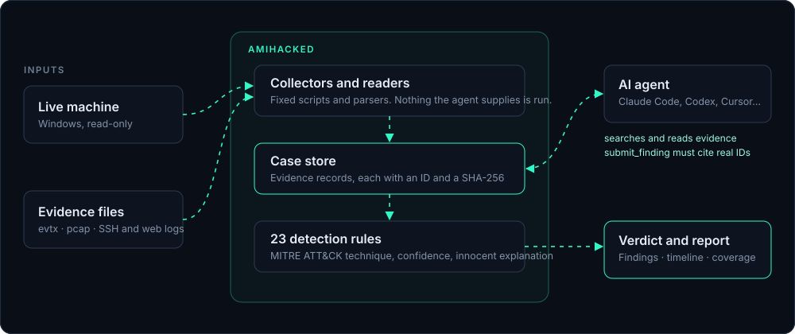

<p align="center">
  
</p>

<p align="center">
  <a href="LICENSE"></a>
  
  
  
  
</p>

<p align="center">
  <b>Give any AI agent the ability to investigate a computer for signs of compromise.</b><br>
  It inspects the live machine or evidence files, and every conclusion must cite the evidence it rests on.
</p>

<p align="center">
  <a href="#quick-start">Quick start</a> ·
  <a href="#how-it-works">How it works</a> ·
  <a href="#what-it-looks-at">What it looks at</a> ·
  <a href="#mcp-tools">MCP tools</a> ·
  <a href="#safety">Safety</a> ·
  <a href="#limits">Limits</a>
</p>

<br>

<p align="center">
  
</p>

<p align="center"><sub>Real output from the bundled example logs.</sub></p>

## Why

An agent can reason about an intrusion, but it cannot see one. Left to run shell
commands on its own, it produces a different investigation every time, and nothing
stops it from stating things it never checked.

amihacked fixes both:

- **It gives the agent eyes.** Fixed collectors turn a machine or a file into structured
  evidence records, each with an ID and a hash.
- **It keeps the agent honest.** Findings, from the built-in rules or from the agent
  itself, are rejected unless they cite records that exist.
- **It needs no lab.** One install, read-only, runs entirely on your machine.

Works with Claude Code, Codex, Cursor, Gemini CLI, or anything else that speaks MCP.

## Quick start

Needs Node.js 20 or newer. amihacked is not on npm yet, so build it from source:

```bash
git clone https://github.com/ekupekuAI/amihacked.git
```

```bash
cd amihacked && npm install && npm run build
```

Try it on the bundled examples, no agent needed:

```bash
node dist/cli.js file examples/auth.log examples/access.log
```

Inspect this computer (Windows):

```bash
node dist/cli.js scan --report case.md
```

Add it to Claude Code, using the full path to your clone:

```bash
claude mcp add amihacked -- node /path/to/amihacked/dist/cli.js mcp
```

Then ask:

```text
Am I hacked? Check this computer and show me the evidence.
```

For other agents, register the same command as a stdio MCP server.

## How it works

<p align="center">
  
</p>

1. **Collect.** Collectors and readers turn the system into evidence records. They are
   fixed scripts and parsers; the agent cannot change what they run.
2. **Detect.** Rules read the evidence and raise findings, each with a severity, a
   confidence, a MITRE ATT&CK technique and the most likely innocent explanation.
3. **Investigate.** The agent searches the evidence, follows the timeline, and records
   its own conclusions. A conclusion that cites no real evidence ID is refused.
4. **Report.** One verdict, the findings with their evidence, and a plain list of what
   could not be checked.

## What it looks at

**The live machine (Windows)**

| Area | What is collected |
| --- | --- |
| Startup | Run keys, Winlogon values, Startup folders |
| Scheduled tasks | Tasks outside `\Microsoft\` |
| Services | Every service and the file it launches |
| Processes | Path, command line, parent, publisher signature |
| Network | Listening ports and open connections, with the owning program |
| Antivirus | Defender state and recorded detections |
| Accounts | Local users and administrators |
| Hosts file | Address overrides |
| Event logs | Failed and remote logons, new accounts, cleared logs, installed services, flagged PowerShell |

**Evidence files (any OS unless noted)**

| File | What is extracted |
| --- | --- |
| pcap / pcapng | Flows, DNS lookups, TLS server names, HTTP requests, unencrypted logins, regular "check-in" traffic, DNS tunnelling |
| SSH auth log | Login attempts per address, password guessing, a success right after many failures |
| Web access log | Requests carrying SQL injection, path traversal, command injection, Log4Shell and scanner signatures |
| Windows `.evtx` | The same security events as the live scan (needs Windows in this version) |

The file type is detected from the content, not the name.

## What you get

- **A verdict**, one of three: no signs of compromise in what was checked, suspicious
  items need a closer look, or strong signs of compromise. The strongest verdict needs
  strong evidence, not a pile of weak signals.
- **Findings** with a severity, a confidence, a MITRE ATT&CK technique, the most likely
  innocent explanation, and the evidence IDs behind them.
- **Coverage**: what was checked and, just as plainly, what could not be.
- **A Markdown report** you can keep or hand to someone else.

## MCP tools

| Tool | Purpose |
| --- | --- |
| `scan_live` | Inspect the machine the server runs on |
| `read_evidence_file` | Read an evidence file into the case |
| `list_evidence`, `get_evidence`, `search_evidence` | Examine the collected records |
| `timeline` | Records in time order, optionally around a moment |
| `submit_finding` | Record the agent's own conclusion; refused without real evidence IDs |
| `report` | Markdown report with verdict, findings, evidence and coverage |
| `new_case` | Start over |

## Safety

- **Read-only.** It never changes, deletes or quarantines anything.
- **Local.** It makes no network connections and uploads nothing.
- **No agent-supplied commands.** Collectors are fixed scripts. Values from the agent
  travel as data and are never spliced into a script.
- **Evidence is treated as hostile.** Text from logs and captures is cleaned and capped,
  and a rule flags content written to steer an AI ("ignore previous instructions...").
- **Passwords are redacted.** A login seen in a capture is recorded by username only.

## Limits

- A clear verdict means nothing was found in the areas listed under Coverage. It does
  not prove a system is clean. Kernel rootkits, firmware implants and malware that
  hides from the operating system are out of reach.
- It is not an antivirus and gives no real-time protection.
- Without administrator rights the Windows Security log cannot be read, so logon and
  account events are missing. The report says so when that happens.
- Rules are heuristics. Each finding states its confidence and an innocent
  explanation; read both before acting.
- Live scanning of macOS and Linux, cross-platform `.evtx`, disk images and memory
  dumps are not supported yet.

## Roadmap

- Live collectors for macOS and Linux
- Pure TypeScript `.evtx` and registry-hive parsers, so evidence files work on any OS
- Browser-extension and WMI persistence collectors
- An npm release, so `npx amihacked` works
- Known-answer cases that grade an agent's conclusions

## Development

```bash
npm install
```

```bash
npm test
```

The design is in [docs/DESIGN.md](docs/DESIGN.md). Issues and pull requests are welcome,
especially new detection rules with a test and an innocent explanation.

## License

[MIT](LICENSE)
